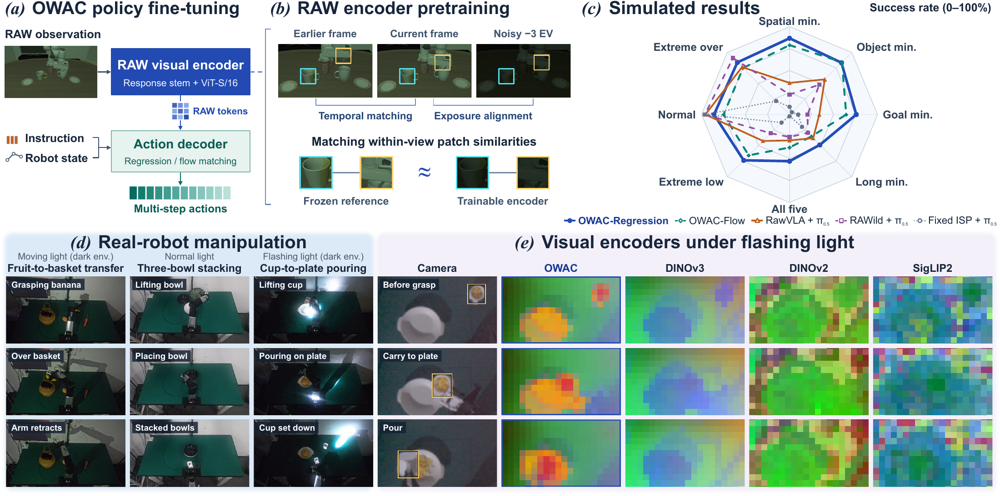
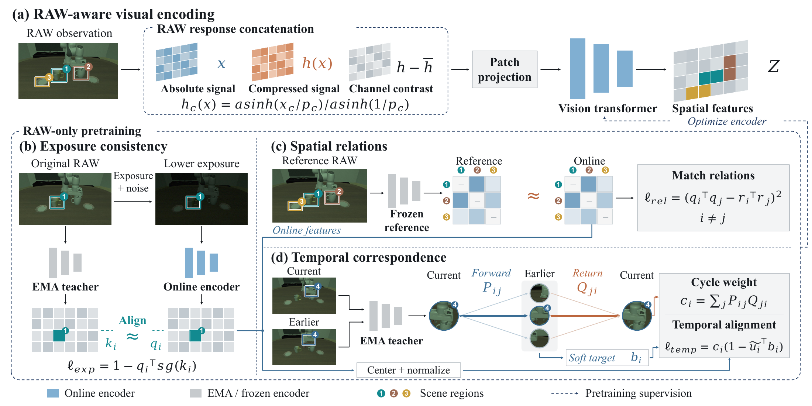
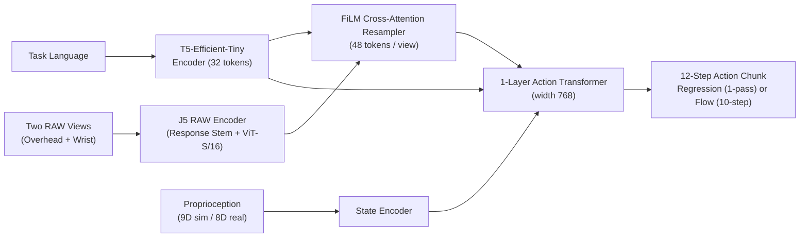
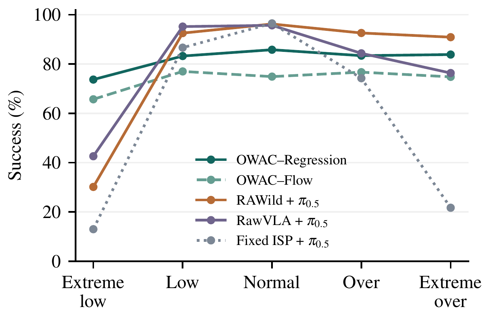
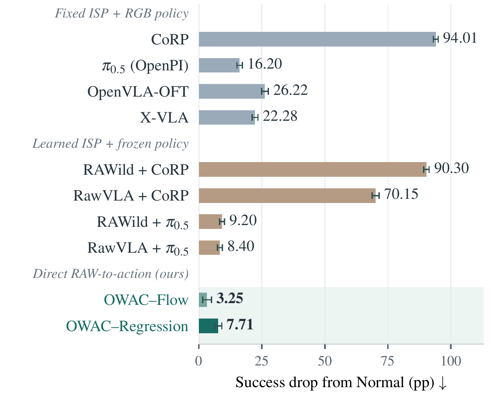
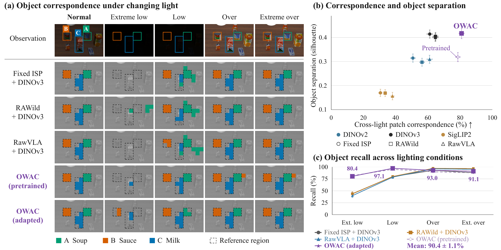

<div align="center">

# OWAC

<h3><b>O</b>ptimizing RA<b>W</b> Representations for Robot Manipulation <b>A</b>cross Lighting <b>C</b>onditions</h3>

<p>
  <a href="https://github.com/PAIR-Z-ZENO-LAB/owac/releases/tag/paper-v1.0.1">
    
  </a>
  <a href="https://huggingface.co/Jeong-USYD/owac-j5-raw-encoder">
    
  </a>
  <a href="https://huggingface.co/datasets/ToferFish/RawVLA-Bench">
    
  </a>
  <a href="pyproject.toml">
    
  </a>
  <a href="LICENSE">
    
  </a>
  <a href="licenses/README.md">
    
  </a>
</p>

<p>
  <a href="#key-highlights">Highlights</a> ·
  <a href="#method">Method</a> ·
  <a href="#experimental-results">Results</a> ·
  <a href="#model-zoo--released-artifacts">Model Zoo</a> ·
  <a href="#quick-start">Quick Start</a> ·
  <a href="#reproduction">Reproduction</a> ·
  <a href="#real-robot-deployment">Real Robot</a> ·
  <a href="#citation">Citation</a>
</p>

<br />



<p align="left">
  <em><b>Figure 1. Manipulation from RAW observations with OWAC.</b> (a) The RAW visual encoder and language-conditioned action decoder are adapted jointly on manipulation demonstrations. (b) RAW-only pretraining aligns patch features across simulated exposure drops and video frames while preserving pairwise similarities within each view. (c) LIBERO radar profiles report worst-lighting success per suite together with paired All-5 reliability. (d) Real-robot deployment on native 10-bit BGGR Bayer cameras across fruit transfer, three-bowl stacking, and cup-to-plate pouring. (e) Principal-component patch features under flashing light compared against RGB foundation encoders.</em>
</p>

</div>

---

> **TL;DR:** **OWAC** learns illumination-robust visuomotor manipulation policies directly from linear RAW sensor measurements—without rendering intermediate RGB images or relying on external RGB visual teachers. By pairing **shot/read noise-calibrated exposure alignment** with **frozen-reference pairwise relation anchoring** and **cycle-weighted temporal correspondence**, OWAC preserves fine object–surface discrimination under severe signal degradation. With only **44.0M–48.9M parameters**, OWAC reaches **82.00%** fixed-light mean and **73.70%** under `ExtremeLow` on LIBERO (**+31.10 pp** over the strongest baseline, `RawVLA + π0.5`), suffers the smallest drop under random lighting transitions (**3.25 pp** / **7.71 pp**), and achieves **90%–100%** success across three physical manipulation tasks under normal, flashing, moving, and dim light.

## News

- **`2026-11-27` — Release [`paper-v1.0.1`](https://github.com/PAIR-Z-ZENO-LAB/owac/releases/tag/paper-v1.0.1):** Published verified SHA-256 checksums for the public J5 RAW encoder alongside byte-identical Safetensors checkpoints (`owac-regression-10000`, `owac-flow-20000`), full J3/J4/J5 pretraining and policy recipes, 40,000+ scored LIBERO episode records, and native RAW10 NERO hardware code.
- **`2026-11-09` — Public J5 RAW Encoder:** Released the standalone RAW-only self-supervised ViT-S/16 encoder on [Hugging Face (`Jeong-USYD/owac-j5-raw-encoder`)](https://huggingface.co/Jeong-USYD/owac-j5-raw-encoder).

---

## Key Highlights

- **Direct RAW-to-Action Without ISP Rendering:** Operates directly on linear sensor measurements—supporting both three-channel simulation pseudo-RAW (RawVLA-Bench) and packed native 10-bit BGGR Bayer streams (physical robot)—retaining photon and noise cues discarded by standard ISP pipelines.
- **Collapse-Resistant RAW Representation Pretraining:** Cross-exposure invariance alone can align bright and dark views by collapsing distinct objects into the background. OWAC resolves this with a three-branch radiometric response stem, physical shot/read noise-calibrated attenuation pairs, frozen-reference pairwise similarity anchoring, VICReg diversity regularization, and forward–backward cycle-weighted temporal alignment—trained strictly from RAW observations without RGB teachers or external visual pretraining.
- **Compact Multimodal Architecture (44M–49M Parameters):** Jointly adapts a 22.2M-parameter ViT-S/16 RAW encoder, 11.4M T5-Efficient-Tiny language encoder, 2.9M FiLM-modulated cross-attention visual resampler, and a single-layer action transformer—supporting both single-pass direct regression (**OWAC-Regression**, 44.0M) and 10-step flow matching (**OWAC-Flow**, 48.9M).
- **Strong Extreme-Light & Dynamic-Switching Reliability:** Across **200,000 LIBERO rollouts** (10 policies × 20,000 trials), OWAC-Regression achieves the highest fixed-light mean (**82.00%**), highest `ExtremeLow` score (**73.70%** vs. 42.60% for `RawVLA + π0.5`), and highest paired **All-5** rate (**53.10%** vs. 29.50%), while OWAC-Flow achieves the lowest cross-regime standard deviation (**4.16 pp**) and smallest switching drop (**3.25 pp**).
- **Verified Native RAW10 Real-Robot Deployment:** On dual global-shutter SmartSens SC235HGS cameras (640×480 BGGR10 at 30 Hz, AE/AG/HDR disabled) and a 7-DoF NERO arm, OWAC achieves **100%** success across every dim-light trial and flashing-light pour where competing ISP/VLA pipelines drop to **0%–20%**.

---

## Method

<div align="center">
  
</div>

<p>
  <em><b>Figure 2. RAW encoding and pretraining in OWAC.</b> (a) Absolute linear signal, compressed faint response, and per-pixel channel contrast are concatenated into patch features via a ViT-S/16 backbone. During RAW-only pretraining, the online encoder (b) aligns patch features across noise-calibrated exposure drops with an EMA teacher, (c) preserves pairwise patch similarities from a frozen normal-light RAW reference, and (d) aligns frames via soft temporal targets weighted by forward–backward return probability.</em>
</p>

### 1. Radiometric Response Encoding & Noise-Calibrated Exposure Pairs

Given linear RAW channels $x_c$ and learned positive scales $p_c$, OWAC builds a three-branch radiometric input representation combining absolute intensity, arcsinh-compressed faint detail, and relative channel contrast before patch projection into spatial features $f_\theta(x) \in \mathbb{R}^{N \times d}$:

$$
h_c(x) = \frac{\operatorname{asinh}(x_c / p_c)}{\operatorname{asinh}(1 / p_c)}, \qquad
\Phi(x) = \bigl[\,x,\; h(x),\; h(x) - \overline{h}(x)\,\bigr]
$$

where $\overline{h}(x)$ is the pixelwise channel mean. To construct physically faithful low-exposure training pairs from unsaturated normal-light measurements $x = s + \epsilon$ with $\mathbb{E}[\epsilon \mid s] = 0$ and $\operatorname{Var}(\epsilon \mid s) = \alpha s + \beta$, attenuating $x$ by $a \in (0, 1]$ reduces existing variance by $a^2$, so OWAC injects only the exact residual shot and read noise variance:

$$
\widetilde{x} = a x + \eta, \qquad
\operatorname{Var}(\eta \mid s) = a(1 - a)\alpha s + (1 - a^2)\beta
$$

This guarantees $\mathbb{E}[\widetilde{x} \mid s] = a s$ and $\operatorname{Var}(\widetilde{x} \mid s) = \alpha a s + \beta$, reproducing real SNR degradation rather than mere rescaling. The online encoder processes $\widetilde{x}$ while an EMA teacher processes $x$, aligning visible unit-normalized patch features $q_i, k_i$ over unmasked indices $\mathcal{V}$:

$$
\mathcal{L}_{\mathrm{exp}} = \frac{1}{|\mathcal{V}|} \sum_{i \in \mathcal{V}} \bigl[1 - q_i^\top \operatorname{sg}(k_i)\bigr]
$$

### 2. Spatial Discrimination via Reference Relation Anchoring

Because $\mathcal{L}_{\mathrm{exp}}$ alone admits spatially collapsed solutions, OWAC anchors off-diagonal pairwise patch similarities of the online encoder to unit features $r_i$ from a frozen normal-light RAW reference encoder (Stage J3). For unit vectors ($d_{ij}^q = \lVert q_i - q_j \rVert_2^2 = 2 - 2 q_i^\top q_j$), this directly preserves pairwise feature distances over $\mathcal{P} = \{(i, j) \mid i, j \in \mathcal{V},\, i \neq j\}$:

$$
\mathcal{L}_{\mathrm{rel}} = \frac{1}{|\mathcal{P}|} \sum_{(i, j) \in \mathcal{P}} \bigl[q_i^\top q_j - \operatorname{sg}(r_i^\top r_j)\bigr]^2
= \frac{1}{4|\mathcal{P}|} \sum_{(i, j) \in \mathcal{P}} \bigl(d_{ij}^q - d_{ij}^r\bigr)^2
$$

Feature diversity across channels is further preserved via VICReg variance and covariance penalties $(\mathcal{L}_{\mathrm{var}}, \mathcal{L}_{\mathrm{cov}})$ applied directly to visible output tokens.

### 3. Cycle-Weighted Temporal Correspondence

Across consecutive frames $(x_t, x_{t-\Delta})$ from the same camera, OWAC computes local forward ($P_{ij}$) and backward ($Q_{ji}$) matching distributions within neighborhood $\mathcal{N}(i)$ from spatially centered, unit-normalized EMA features $(u_i, v_j)$. Earlier-frame candidates form a normalized soft target $b_i$, weighted by its forward–backward cycle return probability $c_i$:

$$
P_{ij} = \frac{\exp(u_i^\top v_j / \tau)}{\sum_{k \in \mathcal{N}(i)} \exp(u_i^\top v_k / \tau)}, \qquad
b_i = \frac{\sum_j P_{ij} v_j}{\lVert \sum_j P_{ij} v_j \rVert_2}, \qquad
c_i = \sum_j P_{ij} Q_{ji}
$$

$$
\mathcal{L}_{\mathrm{temp}} = \frac{1}{|\mathcal{V}|} \sum_{i \in \mathcal{V}} \operatorname{sg}(c_i)\,\bigl[1 - \widetilde{u}_i^\top \operatorname{sg}(b_i)\bigr]
$$

Mutually sharp correspondences carry high weight, while ambiguous textures and occlusions are automatically downweighted. Combined with base RAW self-distillation, masked patch prediction, and feature spreading ($\mathcal{L}_{\mathrm{SSL}}$), pretraining follows a three-stage curriculum:

$$
\mathcal{L}_{\mathrm{RAW}} = \mathcal{L}_{\mathrm{SSL}} + \lambda_e \mathcal{L}_{\mathrm{exp}} + \lambda_r \mathcal{L}_{\mathrm{rel}} + \lambda_v \mathcal{L}_{\mathrm{var}} + \lambda_c \mathcal{L}_{\mathrm{cov}} + \lambda_t \mathcal{L}_{\mathrm{temp}}
$$

| Pretraining Stage | Init / Reference | Updates | Batch | Active Objectives | Recipe |
| :--- | :--- | ---: | ---: | :--- | :--- |
| **J3** (Base RAW SSL) | Random init | 100,000 | 192 | DINO + iBOT + KoLeo ($\mathcal{L}_{\mathrm{SSL}}$) on RAW + response stem | [`j3.json`](configs/paper/j3.json) |
| **J4** (Exposure Consistency) | From J3 EMA | 30,000 | 192 | $\mathcal{L}_{\mathrm{SSL}} + \lambda_e \mathcal{L}_{\mathrm{exp}}$ (2 → 6 EV noise-calibrated drops) | [`j4.json`](configs/paper/j4.json) |
| **J5** (Relations & Motion) | From J4 EMA, frozen J3 anchor | 12,818 | 192 | Full $\mathcal{L}_{\mathrm{RAW}}$ ($\mathcal{L}_{\mathrm{exp}} + \mathcal{L}_{\mathrm{rel}} + \mathcal{L}_{\mathrm{var}} + \mathcal{L}_{\mathrm{cov}} + \mathcal{L}_{\mathrm{temp}}$) | [`j5.json`](configs/paper/j5.json) |

### 4. Joint Policy Adaptation & Decoding Heads



| Component | OWAC-Regression | OWAC-Flow |
| :--- | :--- | :--- |
| **Visual Input (Sim / Real)** | 2 × `256×256` 3-ch pseudo-RAW / 2 × `640×480` 10-bit BGGR Bayer | Same |
| **RAW Visual Encoder** | J5 ViT-S/16 (`d=384`, 12 layers, 6 heads, response stem) — **22.19M** | Same (**22.19M**) |
| **Language Encoder** | Pretrained `google/t5-efficient-tiny` encoder (jointly trained) — **11.37M** | Same (**11.37M**) |
| **Visual Resampler** | CoRP-style FiLM cross-attention, 48 tokens/view, 8 heads — **2.88M** | Same (**2.88M**) |
| **Action Decoder** | 1-layer Transformer, 12 learned horizon queries, masked MSE — **7.35M** | 1-layer DiT, conditional velocity flow matching — **12.17M** |
| **Sampling / Execution** | Single forward pass; predict 12×7 chunk, execute 5 steps | 10 Euler steps; predict 12×7 chunk, execute 5 steps |
| **Auxiliary Supervision** | Task classification CE (`weight = 0.01`) on pooled visual tokens | Same |
| **Total Parameters** | **44,033,202 (44.03M)** | **48,850,866 (48.85M)** |
| **Selected Checkpoint** | 10,000 updates (EMA 0.999) | 20,000 updates (EMA 0.999) |

---

## Experimental Results

### 1. Illumination Robustness on LIBERO (Fixed & Switching Light)

Every policy is evaluated on **40 LIBERO tasks × 50 initial states** across five fixed lighting regimes (**10,000 fixed rollouts**) plus a **switching regime** where lighting changes randomly every 10 native actions (**10,000 switching rollouts**)—totaling **20,000 episodes per method** (200,000 across all 10 policies).

- **All-5 (↑):** Fraction of physical initial states succeeding across *all five* fixed lighting regimes simultaneously.
- **σ (↓):** Cross-regime standard deviation (percentage points) across the five fixed conditions.
- **Switching Δ (↓):** Paired success drop (percentage points) from fixed `Normal` lighting to random lighting transitions on identical initial states.

<table>
  <thead>
    <tr>
      <th rowspan="2" align="left">Method</th>
      <th colspan="5" align="center">Fixed Illumination Success (%) ↑</th>
      <th colspan="3" align="center">Across Fixed Regimes</th>
      <th align="center">Switching</th>
    </tr>
    <tr>
      <th align="right"><b>ExtremeLow</b></th>
      <th align="right">Low</th>
      <th align="right">Normal</th>
      <th align="right">Over</th>
      <th align="right"><b>ExtremeOver</b></th>
      <th align="right">Mean ↑</th>
      <th align="right">All-5 ↑</th>
      <th align="right">σ (pp) ↓</th>
      <th align="right">Δ (pp) ↓</th>
    </tr>
  </thead>
  <tbody>
    <tr><td colspan="10"><em>Direct RAW-to-action (ours)</em></td></tr>
    <tr>
      <td><b>OWAC-Regression</b> (44.0M)</td>
      <td align="right"><b>73.70</b></td>
      <td align="right">83.25</td>
      <td align="right">85.80</td>
      <td align="right">83.40</td>
      <td align="right">83.85</td>
      <td align="right"><b>82.00</b></td>
      <td align="right"><b>53.10</b></td>
      <td align="right">4.25</td>
      <td align="right">7.71</td>
    </tr>
    <tr>
      <td><b>OWAC-Flow</b> (48.9M)</td>
      <td align="right">65.70</td>
      <td align="right">77.00</td>
      <td align="right">74.90</td>
      <td align="right">76.70</td>
      <td align="right">74.80</td>
      <td align="right">73.82</td>
      <td align="right">37.50</td>
      <td align="right"><b>4.16</b></td>
      <td align="right"><b>3.25</b></td>
    </tr>
    <tr><td colspan="10"><em>Fixed ISP + released RGB policy</em></td></tr>
    <tr>
      <td>CoRP</td>
      <td align="right">0.00</td>
      <td align="right">0.00</td>
      <td align="right">94.40</td>
      <td align="right">0.80</td>
      <td align="right">0.00</td>
      <td align="right">19.04</td>
      <td align="right">0.00</td>
      <td align="right">37.68</td>
      <td align="right">94.01</td>
    </tr>
    <tr>
      <td>π<sub>0.5</sub> (OpenPI)</td>
      <td align="right">13.00</td>
      <td align="right">86.65</td>
      <td align="right"><b>96.50</b></td>
      <td align="right">74.25</td>
      <td align="right">21.70</td>
      <td align="right">58.42</td>
      <td align="right">2.00</td>
      <td align="right">34.38</td>
      <td align="right">16.20</td>
    </tr>
    <tr>
      <td>OpenVLA-OFT</td>
      <td align="right">6.70</td>
      <td align="right">71.80</td>
      <td align="right">95.50</td>
      <td align="right">61.95</td>
      <td align="right">18.00</td>
      <td align="right">50.79</td>
      <td align="right">1.05</td>
      <td align="right">33.42</td>
      <td align="right">26.22</td>
    </tr>
    <tr>
      <td>X-VLA</td>
      <td align="right">11.15</td>
      <td align="right">76.25</td>
      <td align="right">96.10</td>
      <td align="right">71.85</td>
      <td align="right">28.45</td>
      <td align="right">56.76</td>
      <td align="right">1.45</td>
      <td align="right">31.74</td>
      <td align="right">22.28</td>
    </tr>
    <tr><td colspan="10"><em>Learned ISP + frozen policy</em></td></tr>
    <tr>
      <td>RAWild + CoRP</td>
      <td align="right">0.00</td>
      <td align="right">1.80</td>
      <td align="right">93.00</td>
      <td align="right">44.30</td>
      <td align="right">36.45</td>
      <td align="right">35.11</td>
      <td align="right">0.00</td>
      <td align="right">34.00</td>
      <td align="right">90.30</td>
    </tr>
    <tr>
      <td>RawVLA + CoRP</td>
      <td align="right">4.30</td>
      <td align="right">56.80</td>
      <td align="right">90.90</td>
      <td align="right">9.10</td>
      <td align="right">3.05</td>
      <td align="right">32.83</td>
      <td align="right">0.00</td>
      <td align="right">35.24</td>
      <td align="right">70.15</td>
    </tr>
    <tr>
      <td>RAWild + π<sub>0.5</sub></td>
      <td align="right">30.15</td>
      <td align="right">92.55</td>
      <td align="right">96.25</td>
      <td align="right"><b>92.60</b></td>
      <td align="right"><b>90.90</b></td>
      <td align="right">80.49</td>
      <td align="right">25.60</td>
      <td align="right">25.23</td>
      <td align="right">9.20</td>
    </tr>
    <tr>
      <td>RawVLA + π<sub>0.5</sub></td>
      <td align="right">42.60</td>
      <td align="right"><b>95.20</b></td>
      <td align="right">95.70</td>
      <td align="right">84.35</td>
      <td align="right">76.35</td>
      <td align="right">78.84</td>
      <td align="right">29.50</td>
      <td align="right">19.50</td>
      <td align="right">8.40</td>
    </tr>
  </tbody>
</table>

<table>
  <tr>
    <td width="52%" align="center">
      <br />
      <sub><b>Fixed-lighting profiles:</b> OWAC remains flat across lighting extremes where ISP pipelines collapse in <code>ExtremeLow</code>.</sub>
    </td>
    <td width="48%" align="center">
      <br />
      <sub><b>Dynamic switching drop (↓):</b> Paired drop from fixed Normal under random switches every 10 actions (with 95% bootstrap CI).</sub>
    </td>
  </tr>
</table>

<details>
<summary><b>Per-Suite Fixed-Light Breakdown (Archived 10,000 Episodes per OWAC Policy)</b></summary>
<br />

| Policy / LIBERO Suite | ExtremeLow | Low | Normal | Over | ExtremeOver | Mean | All-5 |
| :--- | ---: | ---: | ---: | ---: | ---: | ---: | ---: |
| **OWAC-Regression** — Spatial | 86.80 | 89.80 | 94.20 | 94.40 | 95.20 | **92.08** | 71.60 |
| **OWAC-Regression** — Object | 83.40 | 94.80 | 95.80 | 95.60 | 94.20 | **92.76** | 71.60 |
| **OWAC-Regression** — Goal | 75.80 | 85.20 | 87.40 | 85.40 | 90.40 | **84.84** | 54.20 |
| **OWAC-Regression** — Long (LIBERO-10) | 48.80 | 63.20 | 65.80 | 58.20 | 55.60 | **58.32** | 15.00 |
| **OWAC-Flow** — Spatial | 79.00 | 86.20 | 82.40 | 88.40 | 87.20 | **84.64** | 47.80 |
| **OWAC-Flow** — Object | 84.20 | 92.20 | 85.20 | 90.80 | 87.40 | **87.96** | 55.20 |
| **OWAC-Flow** — Goal | 64.40 | 73.20 | 79.60 | 80.60 | 80.40 | **75.64** | 39.60 |
| **OWAC-Flow** — Long (LIBERO-10) | 35.20 | 56.40 | 52.40 | 47.00 | 44.20 | **47.04** | 7.40 |

</details>

---

### 2. Representation Analysis: Illumination Consistency & Object Discrimination

<div align="center">
  
</div>

<p>
  <em><b>Figure 3. Illumination consistency and object discrimination across 11 visual pipelines (40 LIBERO tasks × 2 cameras × 5 lighting regimes).</b> (a) Object labels transferred from each encoder's Normal-light reference via nearest cosine token match. (b) Cross-light exact patch correspondence vs. cosine object silhouette separation. (c) Object-balanced recall across lighting conditions.</em>
</p>

- **High Correspondence Without Feature Collapse:** Pretrained OWAC already raises cross-light exact foreground patch correspondence to **78.59 ± 1.36%**, and policy adaptation further lifts both correspondence (**80.89 ± 1.55%**, vs. **64.70 ± 1.58%** for the strongest ISP + foundation-backbone baseline) and cosine object separation to match DINOv3.
- **Extreme-Low Retention:** Under `ExtremeLow`, adapted OWAC preserves **80.4%** balanced object recall (mean **90.4 ± 1.1%** across shifted regimes), directly mirroring its closed-loop execution margin in dark scenes.

---

### 3. Paired Component Ablation

Evaluated on 40 shared initial states (`initial_index = 0`) × 5 fixed lighting conditions (**200 paired rollouts per arm**). Values report percentage-point differences relative to full **OWAC-Regression** (82.50% mean / 50.00% All-5 on this shared subset).

| Encoder Input | Pretraining Objective | ExtremeLow | Low | Normal | Over | ExtremeOver | Mean (pp) | All-5 (pp) |
| :--- | :--- | ---: | ---: | ---: | ---: | ---: | ---: | ---: |
| **OWAC response** | **Full OWAC** *(reference)* | *75.00%* | *82.50%* | *80.00%* | *87.50%* | *87.50%* | *82.50%* | *50.00%* |
| Linear patch | Full OWAC | −7.50 | −5.00 | +5.00 | −10.00 | −12.50 | −6.00 | −7.50 |
| OWAC response | Base SSL | −2.50 | −15.00 | −5.00 | −12.50 | −20.00 | −11.00 | −12.50 |
| Linear patch | Base SSL | −20.00 | −12.50 | −17.50 | −30.00 | −35.00 | −23.00 | −22.50 |

> **Protocol Note:** As documented in [`docs/paper-reproduction.md`](docs/paper-reproduction.md#reproduce-the-paired-ablation), the control checkpoints (`patch-full` at 4k, `owac-standard` at 4k, `patch-standard` at 3k, vs. full OWAC at 10k) were selected retrospectively at different action update budgets; all 800 per-episode records are released in [`ablation-episodes.jsonl.gz`](research/experiments/results/paper-v1.0/ablation-episodes.jsonl.gz).

---

### 4. Real-Robot Manipulation on Native 10-Bit BGGR Bayer Streams

Evaluated on a 7-DoF right NERO follower arm with overhead and wrist **SmartSens SC235HGS** global-shutter cameras (`640×480` center-cropped, 2×2 binned, `95.1° × 78.7°` FoV, 30 Hz, linear packed **RAW10 BGGR** with AE/AG/HDR disabled). Each policy is trained on **30 demonstrations per task** and evaluated over **20 trials per lighting condition** (`N`: Normal, `F`: Flashing, `M`: Moving light, `D`: Dim light).

<table>
  <thead>
    <tr>
      <th rowspan="2" align="left">Method</th>
      <th colspan="4" align="center">Fruit-to-Basket Transfer (%)</th>
      <th colspan="4" align="center">Three-Bowl Stacking (%)</th>
      <th colspan="4" align="center">Cup-to-Plate Pouring (%)</th>
      <th rowspan="2" align="right">Avg.</th>
    </tr>
    <tr>
      <th align="right">N</th><th align="right">F</th><th align="right">M</th><th align="right">D</th>
      <th align="right">N</th><th align="right">F</th><th align="right">M</th><th align="right">D</th>
      <th align="right">N</th><th align="right">F</th><th align="right">M</th><th align="right">D</th>
    </tr>
  </thead>
  <tbody>
    <tr>
      <td><b>OWAC (ours)</b></td>
      <td align="right"><b>100</b></td><td align="right"><b>95</b></td><td align="right"><b>95</b></td><td align="right"><b>100</b></td>
      <td align="right"><b>100</b></td><td align="right"><b>90</b></td><td align="right"><b>95</b></td><td align="right"><b>100</b></td>
      <td align="right"><b>100</b></td><td align="right"><b>100</b></td><td align="right"><b>90</b></td><td align="right"><b>100</b></td>
      <td align="right"><b>97.1</b></td>
    </tr>
    <tr>
      <td>DINOv3 + CoRP</td>
      <td align="right"><b>100</b></td><td align="right">20</td><td align="right">25</td><td align="right">60</td>
      <td align="right"><b>100</b></td><td align="right">10</td><td align="right">40</td><td align="right">75</td>
      <td align="right">95</td><td align="right">0</td><td align="right">10</td><td align="right">0</td>
      <td align="right">44.6</td>
    </tr>
    <tr>
      <td>RawVLA + π<sub>0.5</sub></td>
      <td align="right">95</td><td align="right">55</td><td align="right">60</td><td align="right">75</td>
      <td align="right">90</td><td align="right">35</td><td align="right">45</td><td align="right">45</td>
      <td align="right"><b>100</b></td><td align="right">20</td><td align="right">10</td><td align="right">5</td>
      <td align="right">52.9</td>
    </tr>
    <tr>
      <td>RAWild + π<sub>0.5</sub></td>
      <td align="right"><b>100</b></td><td align="right">30</td><td align="right">55</td><td align="right">40</td>
      <td align="right"><b>100</b></td><td align="right">55</td><td align="right">60</td><td align="right">35</td>
      <td align="right"><b>100</b></td><td align="right">15</td><td align="right">40</td><td align="right">25</td>
      <td align="right">54.6</td>
    </tr>
  </tbody>
</table>

<p>
  <sub><b>Task criteria:</b> <em>Fruit-to-Basket Transfer</em> — banana remains in the basket after release; <em>Three-Bowl Stacking</em> — three bowls stacked in sequence; <em>Cup-to-Plate Pouring</em> — corn kernels poured from cup onto plate. <b>Avg.</b> is the equal-weighted mean across all 12 task–lighting cells.</sub>
</p>

---

## Model Zoo & Released Artifacts

| Artifact | Scope / Checkpoint | Size | Params | License | Link |
| :--- | :--- | ---: | ---: | :--- | :--- |
| **`owac-regression-10000.safetensors`** | LIBERO 40-task EMA policy (10k updates; 82.00% Fixed / 78.09% Switching) | 199.4 MiB | 44.03M | CC BY-NC 4.0 | [GitHub Release (`paper-v1.0.1`)](https://github.com/PAIR-Z-ZENO-LAB/owac/releases/tag/paper-v1.0.1) |
| **`owac-flow-20000.safetensors`** | LIBERO 40-task EMA policy (20k updates; 73.82% Fixed / 71.65% Switching) | 217.8 MiB | 48.85M | CC BY-NC 4.0 | [GitHub Release (`paper-v1.0.1`)](https://github.com/PAIR-Z-ZENO-LAB/owac/releases/tag/paper-v1.0.1) |
| **`owac-j5-raw-encoder` (`encoder.pt`)** | Standalone RAW-only ViT-S/16 encoder (Stage J5 EMA, step 12,818; 212 tensors) | 84.7 MiB | 22.19M | See model card | [Hugging Face (pinned commit)](https://huggingface.co/Jeong-USYD/owac-j5-raw-encoder/tree/b042fdd6cd5066c8871fbaf19dc84a906acc9000) |
| **Scored Episode Archives** | 40,000 main rollouts (Fixed + Switching) & 800 paired ablation rollouts | 1.3 MiB | — | PolyForm-NC | [`research/experiments/results/paper-v1.0/`](research/experiments/results/paper-v1.0) |
| **Simulation Benchmark Data** | RawVLA-Bench (LIBERO & RoboTwin pseudo-RAW trajectories) | External | — | Upstream terms | [Hugging Face (`RawVLA-Bench`)](https://huggingface.co/datasets/ToferFish/RawVLA-Bench/tree/8586c594fff9ce38580e29745f074e82e96e74f7) |
| **Real-Robot Data & Weights** | Physical MCAP demonstrations, on-robot weights & field profiles | Private | — | Not public | Pipeline code in [`docs/real-robot-reproduction.md`](docs/real-robot-reproduction.md) |

---

## Quick Start

### Run a Released Policy

Requires Linux, Git, `curl`, and [`uv`](https://docs.astral.sh/uv/). The offline tokenizer and training-only normalization statistics are bundled; inference runs on CPU with no internet access after download.

```bash
# 1. Clone the verified paper release and install the locked environment
git clone --branch paper-v1.0.1 https://github.com/PAIR-Z-ZENO-LAB/owac.git
cd owac
uv sync --python 3.12 --locked --extra paper

# 2. Download both selected EMA checkpoints and verify SHA-256 checksums
mkdir -p outputs/models
base=https://github.com/PAIR-Z-ZENO-LAB/owac/releases/download/paper-v1.0.1
for file in owac-regression-10000.safetensors owac-flow-20000.safetensors SHA256SUMS
do
  curl -fL --retry 3 "$base/$file" -o "outputs/models/$file"
done
(cd outputs/models && sha256sum -c SHA256SUMS)

# 3. Run offline CPU inference on a deterministic synthetic input (prints 12 × 7 delta actions)
.venv/bin/python -m owac.paper.infer \
  --checkpoint outputs/models/owac-regression-10000.safetensors
```

### Run on a Public RawVLA-Bench Trajectory

```bash
dataset=https://huggingface.co/datasets/ToferFish/RawVLA-Bench/resolve/8586c594fff9ce38580e29745f074e82e96e74f7
sample=data/libero/raw/libero_10_no_noops_1.0.0_lerobot/episode_000001/variant_00.npz
curl -fL --retry 3 "$dataset/$sample" -o outputs/example.npz

# Predict a 12 × 7 action chunk with OWAC-Flow (or swap in owac-regression-10000.safetensors)
.venv/bin/python -m owac.paper.infer \
  --episode outputs/example.npz --frame 0 \
  --checkpoint outputs/models/owac-flow-20000.safetensors \
  --output outputs/actions.npy
```

To extract standalone `384`-D CLS and `16×16×384` spatial patch descriptors with the public J5 encoder (`owac.paper.encode`), see [`docs/paper-reproduction.md`](docs/paper-reproduction.md#train-the-raw-encoder-and-both-action-policies).

---

## Reproduction

### Re-score All 40,000 Archived Trials (No Simulator Required)

Recompute the exact fixed-light, All-5, and switching-light metrics in Table I directly from the released compressed episode journals:

```bash
mkdir -p outputs/paper
manifest_path=experiments/simulation/libero/manifests/libero_manifest_50_init_states_10000_rollouts.json
curl -fL "https://raw.githubusercontent.com/ShuhongLL/RawVLA/ba9c56b04da2c4931b70d8844710f5928d43775b/$manifest_path" \
  -o outputs/paper/libero-manifest.json

for head in regression flow
do
  d=research/experiments/results/paper-v1.0/$head
  .venv/bin/python -m owac.paper.score \
    --manifest outputs/paper/libero-manifest.json \
    --fixed "$d/fixed" --switching "$d/switching"
done
```

### Full Simulation, Pretraining & Ablation Guides

| Goal | Guide / Entry Point |
| :--- | :--- |
| Run closed-loop native LIBERO evaluation (`--mode fixed` / `--mode switching`) | [`docs/paper-reproduction.md#run-native-libero`](docs/paper-reproduction.md#run-native-libero) |
| Train the J3 → J4 → J5 RAW encoder from scratch & both LIBERO policies | [`docs/paper-reproduction.md#train-the-raw-encoder-and-both-action-policies`](docs/paper-reproduction.md#train-the-raw-encoder-and-both-action-policies) |
| Reproduce the paired 2×2 encoder/objective ablation arms | [`docs/paper-reproduction.md#reproduce-the-paired-ablation`](docs/paper-reproduction.md#reproduce-the-paired-ablation) · [`configs/paper/ablations/`](configs/paper/ablations) |
| Inspect exact training hyperparameters, splits, and scoring journals | [`configs/paper/`](configs/paper) · [`data/manifests/paper-rawvla.jsonl`](data/manifests/paper-rawvla.jsonl) · [`research/experiments/results/paper-v1.0/`](research/experiments/results/paper-v1.0) |

---

## Real-Robot Deployment

The physical platform pipeline consumes two synchronized **640×480 packed 10-bit BGGR Bayer** camera streams (`U2` overhead, `U3` wrist) together with 7-DoF follower joint positions (radians) and gripper opening (metres) over ROS 2 Jazzy.

- **Hardware Capture & ROS 2 Message:** [`hardware/nero/OwacRawFrame.msg`](hardware/nero/OwacRawFrame.msg), [`hardware/nero/owac_raw.py`](hardware/nero/owac_raw.py), and [`hardware/nero/owac_raw_camera_ros2.py`](hardware/nero/owac_raw_camera_ros2.py).
- **Local MCAP Conversion, Vision Continuation & Policy Training:** End-to-end commands (`owac.raw.teleop_mcap`, `owac.paper.teleop`, `owac.training.raw_ssl_train`, `owac.training.teleop_policy_train`) and live operator consoles (`scripts/fruit-infer`, `scripts/bowl-infer`, `scripts/pouring-infer`) are documented in **[`docs/real-robot-reproduction.md`](docs/real-robot-reproduction.md)**.

---

## Repository Structure

```text
owac/
├── configs/
│   ├── paper/                          # J3, J4, J5 encoder & regression/flow policy recipes
│   │   └── ablations/                  # 2×2 paired ablation configs (encoder × objective)
│   └── runtime/                        # Real-robot field deployment catalogs
├── data/manifests/
│   └── paper-rawvla.jsonl              # Fixed 1,923 / 240 / 240 train/val/test trajectory split
├── docs/
│   ├── assets/                         # Figures rendered for this README
│   ├── paper-reproduction.md           # Full simulation, training, scoring & ablation guide
│   └── real-robot-reproduction.md      # Native RAW10 MCAP training & NERO deployment guide
├── hardware/nero/                      # ROS 2 OwacRawFrame.msg & packed RAW10 camera bridge
├── licenses/                           # CC BY-NC 4.0 text & third-party license attribution
├── research/experiments/results/
│   └── paper-v1.0/                     # 40,000 scored main rollouts + 800 ablation records
├── scripts/                            # Field inference consoles (fruit/bowl/pouring) & analysis
└── src/owac/
    ├── paper/                          # Public CLI: infer, encode, evaluate, score, prepare, teleop
    ├── frameworks/raw_compact/         # Multimodal policy modules & vendored CoRP components
    └── training/                       # RAW SSL (J3–J5), policy trainers & teleop data loaders
```

---

## Scope & Limitations

- **Normal-Light Capacity Trade-Off:** Training a compact 22.2M RAW ViT-S/16 from scratch trails billion-parameter RGB backbones pretrained on web-scale data under ideal normal illumination (85.80% vs. 96.50% for `π0.5`), while delivering substantial gains under extreme low light and dynamic illumination transitions.
- **Unsaturated Noise Modeling:** Synthetic exposure attenuation models shot and read noise in unsaturated low-light regimes rather than highlight clipping; scaling native Bayer pretraining across broader sensors and long-horizon tasks remains important future work.
- **Simulation vs. Hardware Modalities:** Released simulation checkpoints operate on three-channel LIBERO pseudo-RAW (`7`-D delta actions), whereas physical deployment trains directly on packed 10-bit BGGR Bayer frames (`8`-D joint/gripper space). Original physical demonstrations and on-robot weights remain private.
- **CPU Thread Sensitivity:** Single-trial closed-loop LIBERO runs on CPU can vary with BLAS/OpenMP thread counts despite initial action differences below $10^{-6}$; record device and thread settings when comparing individual trajectories (see [`paper-v1.0.1` release notes](https://github.com/PAIR-Z-ZENO-LAB/owac/releases/tag/paper-v1.0.1)).

---

## Acknowledgements

OWAC builds upon and compares against open-source robotics and vision foundations including [CoRP](https://github.com/corp-policy/CoRP), [RawVLA & RawVLA-Bench](https://github.com/ShuhongLL/RawVLA), [LIBERO](https://github.com/Lifelong-Robot-Learning/LIBERO), [OpenPI](https://github.com/Physical-Intelligence/openpi), [Google T5-Efficient-Tiny](https://huggingface.co/google/t5-efficient-tiny), [DINOv2](https://github.com/facebookresearch/dinov2) / [DINOv3](https://github.com/facebookresearch/dinov3), and the [NERO collection stack](https://github.com/PAIR-Z-ZENO-LAB/agilx-teleop-collection). Upstream provenance and local modifications are recorded in [`src/owac/frameworks/raw_compact/_vendor/provenance.json`](src/owac/frameworks/raw_compact/_vendor/provenance.json) and [`licenses/README.md`](licenses/README.md).

---

## License

- **Source Code:** OWAC-authored source code is licensed under the **[PolyForm Noncommercial License 1.0.0](LICENSE)**.
- **Released Policy Checkpoints:** OWAC contributions to `owac-regression-10000.safetensors` and `owac-flow-20000.safetensors` are licensed under **[Creative Commons Attribution-NonCommercial 4.0 International (CC BY-NC 4.0)](licenses/CC-BY-NC-4.0.txt)**.
- **Third-Party Components:** Vendored modules (CoRP, T5 tokenizer/weights) and external datasets/simulators retain their respective licenses; see **[`licenses/README.md`](licenses/README.md)** for full notices.

---

## Citation

If you find OWAC useful in your research, please cite this release and specify the release tag and checkpoint used:

```bibtex
@software{owac2026,
  author  = {{OWAC contributors}},
  title   = {OWAC: Optimizing RAW Representations for Robot Manipulation Across Lighting Conditions},
  year    = {2026},
  version = {1.0.1},
  url     = {https://github.com/PAIR-Z-ZENO-LAB/owac}
}
```

Machine-readable citation metadata is provided in [`CITATION.cff`](CITATION.cff).
