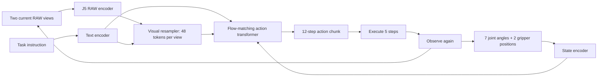

# OWAC: Compact Policies from RAW Observations

**Learning robot manipulation from RAW images, proprioception, and task language.**

[Release v1.0](docs/releases/v1.0.md) · [Results](#results) · [Getting started](#getting-started) · [Training and evaluation](docs/raw-compact-policy.md) · [Citation](#citation)

OWAC studies how sensor-domain visual representations can support robot action directly. The current **C1** policy jointly learns a RAW visual encoder, language-conditioned visual resampling, proprioceptive encoding, and a compact flow-matching action model. It consumes RAW observations without producing an intermediate RGB image.

On the LIBERO subset of RawVLA-Bench, C1 achieves **75.65% average success over 2,000 closed-loop episodes**, covering **40 tasks and five lighting conditions**, with **48.85 million parameters**.

## News

- **2026-11-04 — v1.0:** completed RAW visual-encoder and action-policy training, and released the implementation, experiment configuration, evaluation summaries, and result figures. See the [release notes](docs/releases/v1.0.md).

## Overview

- **Direct RAW-to-action learning.** Two camera views, joint and gripper observations, and a language instruction condition a single manipulation policy.
- **Compact joint optimization.** An internally trained RAW encoder is coupled to a CoRP-style resampler and a one-layer flow transformer. The visual, language, proprioceptive, and action modules are optimized together.
- **No RGB teacher or external visual pretraining in C1.** Visual initialization comes from our J5 RAW-only self-supervised encoder. The language and action networks are initialized randomly; only the text tokenizer is reused.
- **Selection by task success.** Checkpoints are selected using native closed-loop success, with a separate final evaluation on initial states excluded from checkpoint selection.

C1 adapts mature [CoRP](https://github.com/corp-policy/CoRP) components to the RAW setting. This release establishes a working research baseline; the architecture and training-data coverage changed together relative to our earlier policy, so the results do not isolate the contribution of either change.

## Method



| Component | C1 configuration |
|---|---|
| Visual input | Two current 256 × 256, three-channel pseudo-RAW views |
| RAW encoder | J5, ViT-S/16 configuration; initialized from our RAW-only checkpoint |
| Language | T5-Efficient-Tiny encoder architecture, trained from random weights; 32-token input |
| Proprioception | Seven robot joint angles and two finger positions |
| Visual resampling | 48 task-conditioned tokens per camera view |
| Action model | One-layer, width-768 CoRP-style DiT; flow matching |
| Action execution | Predict 12 × 7 actions; 10 Euler sampling steps; execute five actions before replanning |
| Model size | 48,850,866 total parameters |

Training uses expert action supervision and a task-classification auxiliary objective. State normalization and action quantiles are fitted only on training sources. The policy uses current observations without a persistent hidden state across planning calls. See the [model implementation](src/owac/frameworks/raw_compact/policy.py) and [experiment design](docs/plans/RAW_COMPACT_POLICY_2026-11-04.md).

## Results

### Success across lighting and task suites

The selected **20,000-step EMA checkpoint** is evaluated on 40 tasks × 10 initial states × 5 lighting conditions. Each suite–lighting cell contains 100 episodes. All rows and columns use the same checkpoint.

| Task suite | Normal | Low | ExtremeLow | Over | ExtremeOver | Average |
|---|---:|---:|---:|---:|---:|---:|
| Spatial | 82.00 | 94.00 | 79.00 | 87.00 | 79.00 | **84.20** |
| Object | 83.00 | 93.00 | 88.00 | 93.00 | 89.00 | **89.20** |
| Goal | 85.00 | 73.00 | 67.00 | 88.00 | 80.00 | **78.60** |
| Long (LIBERO-10) | 59.00 | 59.00 | 32.00 | 52.00 | 51.00 | **50.60** |
| **Average** | **77.25** | **79.75** | **66.50** | **80.00** | **74.75** | **75.65** |

All values are success rates (%). The overall average weights all four suites and all five lighting conditions equally, and equals **1,513 / 2,000** successful episodes.

### Comparison with the RawVLA report

| Method | Normal | Low | ExtremeLow | Over | ExtremeOver | Average |
|---|---:|---:|---:|---:|---:|---:|
| Default ISP + π0.5, reported | 96.75 | 59.55 | 3.60 | 75.95 | 21.75 | 51.52 |
| RawVLA + π0, reported | 90.30 | 84.35 | 40.70 | 75.30 | 58.25 | 69.78 |
| RawVLA + π0.5, reported | 96.10 | 89.20 | 38.72 | 81.50 | 66.65 | 74.44 |
| RawVLA + Qwen3-OFT, reported | 96.95 | 81.35 | 14.05 | 82.50 | 36.35 | 62.24 |
| **OWAC C1, measured** | **77.25** | **79.75** | **66.50** | **80.00** | **74.75** | **75.65** |

Published values are from [RawVLA, Table 1](https://arxiv.org/html/2609.37530v1#S4.T1). The official main protocol uses **10,000 episodes per model**; C1 uses **2,000 episodes** with a separate initial-state and seed schedule. These are reported-score comparisons, not paired reproductions or a statistical significance claim.

C1's average is 1.21 percentage points above the reported RawVLA + π0.5 average, with stronger scores under extreme illumination and weaker scores under normal light. Across lighting conditions, **SOG** (Spatial, Object, Goal combined) scores **84.00% vs. 79.82%**, while **Long** scores **50.60% vs. 58.28%**. Overall success is `0.75 × SOG + 0.25 × Long`.


### Evaluation protocol

- **Training data:** 1,421 source trajectories and 211,114 frames across five lighting conditions; 177 validation sources and 173 held-out source trajectories in the original split.
- **Training schedule:** 80,000 optimizer updates, global batch 256, two RTX 5090 GPUs, and EMA decay 0.999.
- **Checkpoint selection:** Normal lighting, 40 tasks × five initial states (indices 5–9), at 5k, 10k, 20k, 40k, 60k, and 80k updates. The 20k checkpoint scores **157/200 = 78.5%**.
- **Final evaluation:** Initial states 20–29, all 40 tasks and five lighting conditions; these episodes are excluded from checkpoint selection.
- **Scope:** One training seed, known task instructions, and simulation using three-channel pseudo-RAW. The final evaluation is not an unseen-task test or an evaluation of the 173 held-out demonstration trajectories. Native Bayer inputs and physical-robot performance are not evaluated in this release.

The 80k checkpoint has lower offline action error but lower development success (**72.5%**) than the selected 20k checkpoint. Long-horizon execution and normal-light manipulation remain the main areas for improvement.

[Full report and 40-task breakdown (中文)](research/experiments/raw_compact_c1_results_20261104.md) · [Results JSON](research/archives/2026-11-04_raw_compact_c1_results.json) · [Official-comparison JSON](research/archives/2026-11-04_raw_compact_c1_vs_rawvla.json)

## Getting started

### Install the core development environment

The lightweight development environment requires **Python 3.11+** and **uv**.

```bash
git clone https://github.com/Jeong-zju/owac.git
cd owac
uv sync --locked
uv run --locked python -c "import owac; print(owac.__file__)"
```

`main` contains the current implementation and documentation. Use the [`v1.0` tag](https://github.com/Jeong-zju/owac/tree/v1.0) for the released experiment snapshot.

The core environment does not install the CUDA training stack or the simulator. The experiment used separate policy and simulation runtimes; the [training and evaluation guide](docs/raw-compact-policy.md) documents their dependencies, external assets, configuration fields, and executed entry points.

| I want to… | Start here |
|---|---|
| Understand the policy | [C1 model](src/owac/frameworks/raw_compact/policy.py) and [design](docs/plans/RAW_COMPACT_POLICY_2026-11-04.md) |
| Prepare data or train C1 | [Training and evaluation guide](docs/raw-compact-policy.md) |
| Inspect the released configuration | [`raw_compact_c1.json`](configs/experiments/raw_compact_c1.json) |
| Evaluate a checkpoint | [Closed-loop evaluation](docs/raw-compact-policy.md#closed-loop-evaluation) |
| Compare task and lighting scores | [Full results](research/experiments/raw_compact_c1_results_20261104.md) |
| Trace earlier experiments | [Research index](research/README.md) and [experiment history](research/experiments/raw_compact_c1_20261104.md) |

## Data and model availability

The input trajectories come from [RawVLA-Bench](https://huggingface.co/datasets/ToferFish/RawVLA-Bench). C1 consumes its RAW observations, robot states, actions, and task text; paired RGB images are not used as training targets. The benchmark's LIBERO observations are synthetic three-channel pseudo-RAW rather than native Bayer measurements.

| Artifact | Availability |
|---|---|
| Policy, training, and evaluation source | This repository |
| Experiment configuration and numeric summaries | [`configs/experiments/`](configs/experiments/raw_compact_c1.json) and [`research/archives/`](research/archives/2026-11-04_raw_compact_c1_results.json) |
| Evaluation figures | [PNG and SVG](research/experiments/results/raw_compact_c1_20261104/) |
| J5 visual initialization and C1 policy weights | Archived in the original experiment environment; a public checkpoint download is not included in v1.0 |
| Full videos, trajectories, and training logs | Retained in the experiment archive; locations are recorded in the [release notes](docs/releases/v1.0.md) |

The selected policy is the **20k EMA**, not the final 80k training checkpoint. Reproducing the reported score requires the archived initialization, dataset inventory, tokenizer, and simulation runtime described in the [guide](docs/raw-compact-policy.md).

## Repository structure

```text
configs/experiments/raw_compact_c1.json    # C1 experiment specification
src/owac/frameworks/raw_compact/          # Multimodal policy and vendored CoRP modules
src/owac/training/compact_data.py         # RAW, language, state, and action loading
src/owac/training/compact_train.py        # Distributed training and offline validation
src/owac/runtime/compact_experiment.py    # Training, development, and final evaluation
src/owac/runtime/compact_policy_server.py # Policy inference service
src/owac/runtime/compact_rollouts.py      # Native LIBERO closed-loop evaluation
src/owac/runtime/compact_swanlab.py       # Unified training and evaluation logging
research/experiments/                    # Experiment reports and figures
research/archives/                       # Machine-readable research summaries
docs/                                   # Reproduction guides, releases, and design records
```

Earlier representation-learning and policy-adaptation experiments remain in the repository for traceability. Their historical configurations and results are documented separately from C1.

## Acknowledgements

C1 builds on [CoRP](https://github.com/corp-policy/CoRP), [RawVLA and RawVLA-Bench](https://github.com/ShuhongLL/RawVLA), [LIBERO](https://github.com/Lifelong-Robot-Learning/LIBERO), and [OpenPI](https://github.com/Physical-Intelligence/openpi), with PyTorch and Hugging Face Transformers. The [CoRP provenance record](src/owac/frameworks/raw_compact/_vendor/provenance.json) identifies the imported modules, upstream revision, and local changes.

## Licensing

Vendored CoRP modules retain their [Apache-2.0 license](src/owac/frameworks/raw_compact/_vendor/LICENSE). Other third-party code, datasets, model assets, and simulators retain their respective licenses. A project-level license for the original OWAC code has not yet been specified.

## Citation

If you use this implementation or its released results, please cite the software release:

```bibtex
@software{owac2026,
  author  = {{OWAC contributors}},
  title   = {OWAC: Compact Policies from RAW Observations},
  year    = {2026},
  version = {1.0},
  url     = {https://github.com/Jeong-zju/owac}
}
```

See [CITATION.cff](CITATION.cff) for machine-readable citation metadata. Please also cite the upstream methods and benchmark when using their components or data.
