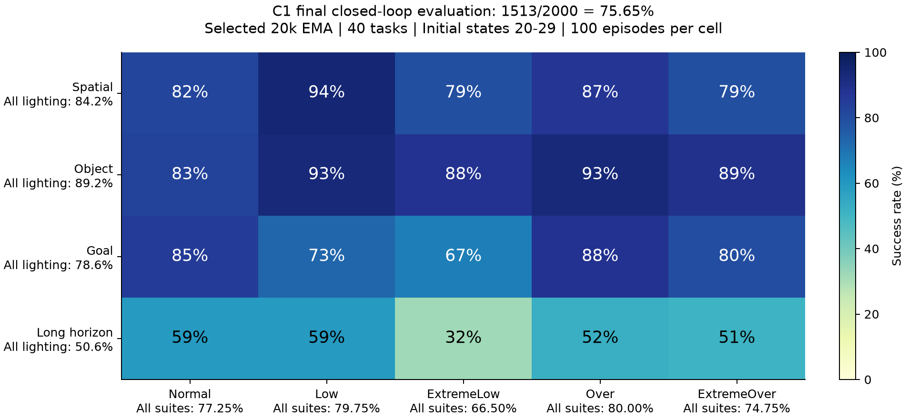

# v1.0：RAW视觉编码器与动作训练成功

发布日期：2026-11-04。用户确认本轮视觉编码器和动作训练成功，将当前全部源码、监测整理与研究记录归档为`v1.0`。

## 成功里程碑

视觉编码器已完成自有RAW-only表征训练，并在C1中与本体、语言和动作模块联合优化；策略直接消费双视角RAW、9维机器人本体与任务语言，无RGB教师或外部视觉预训练权重。动作训练及原生多任务闭环完整走通，形成约4885万参数的紧凑策略。

累计完成80,000次优化器更新。按Normal开发集选择20,000步EMA，开发成绩157/200（78.5%）；在未参与本轮检查点选择的初态20–29、40任务、五种照明上完成2,000场最终评价，成功1,513场，**平均成功率75.65%**。

| 光照 | 平均成功率 | 任务类别 | 五照明平均成功率 |
|---|---:|---|---:|
| Normal | 77.25% | Spatial | 84.20% |
| Low | 79.75% | Object | 89.20% |
| ExtremeLow | 66.50% | Goal | 78.60% |
| Over | 80.00% | Long（LIBERO-10） | 50.60% |
| ExtremeOver | 74.75% | 总体 | **75.65%** |

与RawVLA官方最强RawVLA＋π0.5报告值74.44%相比，本轮平均分数高1.21个百分点；极端照明有优势，Normal和长任务仍有差距。官方主结果10,000场，本轮2,000场，属于公开报告值横评。完整表格、初态协议及来源见[结果报告](../../research/experiments/raw_compact_c1_results_20261104.md)。

本次成功标记对应当前pseudo-RAW仿真、同40个任务的研究阶段；真实Bayer相机、实机与未见任务泛化仍需后续实验。80k末模型开发成功率72.5%，所以v1.0选定策略明确保留为20k EMA。

## 本次归档

- RAW紧凑策略的完整训练、恢复、仿真闭环与检查点选择实现。
- SwanLab训练和闭环统一run、按模型步数显示曲线，初筛/开发/最终评价分开记录。
- 历史重复监测run的合并映射、研究台路线、分析脚本、研究方案和实验记录。
- 本轮逐类别/光照汇总、官方横评数据以及可在GitHub直接查看的PNG/SVG图。

## 选定权重与证据

- 完整训练检查点：服务器`/root/owac/repo/outputs/raw-compact-c1-20261104/training/step-020000.pt`。
- 选定EMA推理权重：同运行根`final-results-20261104/policy-selected-020000-ema.pt`，195,535,466字节；配置和来源见同目录`policy-manifest.json`。
- 原始视频、轨迹、日志、失败和全部历史检查点继续保留在运行目录；权重和大产物按仓库规则在外部存储，不打进Git源码标签。
- [实验记录](../../research/experiments/raw_compact_c1_20261104.md)、[结果JSON](../../research/archives/2026-11-04_raw_compact_c1_results.json)、[官方比较JSON](../../research/archives/2026-11-04_raw_compact_c1_vs_rawvla.json)。
- [OWAC SwanLab](https://swanlab.cn/@Jeong/OWAC/runs/owac-raw-compact-j5-20261104)：FINISHED；group=`C-raw-compact`，job_type=`raw-proprio-language-flow`。

## 发布前检查

2026-11-04本地运行相关测试：**27通过、1跳过**。跳过项因本地没有可选`transformers`；服务器实际训练、模型行为检查与完整闭环证据见实验记录。本次没有重跑训练或仿真。

本轮策略/监测及相关测试7个Python文件的Ruff和格式检查通过。按仓库要求执行`make check`，全库仍有此前记录的213项lint问题，包含历史分析脚本；未将全库检查报告为通过。日志保留在`outputs/v1.0-20261104/`。
