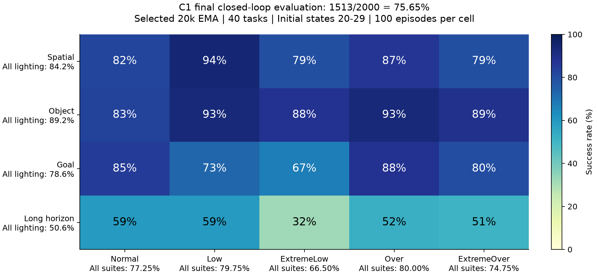
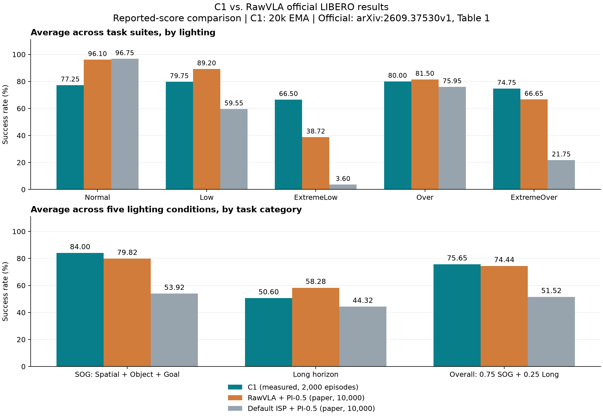
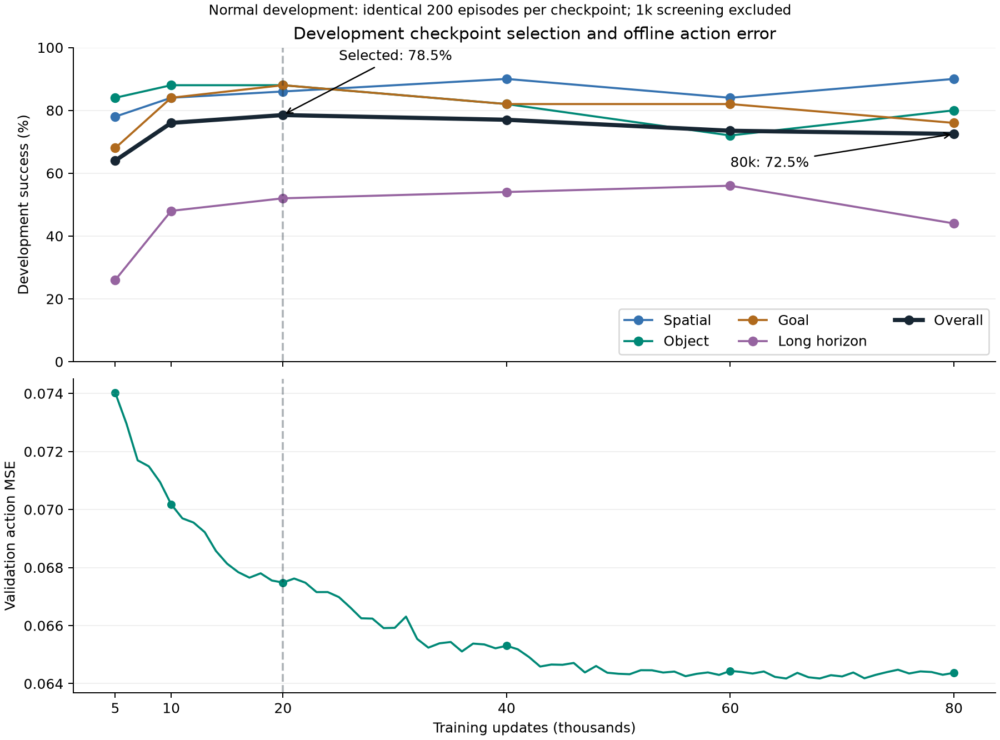
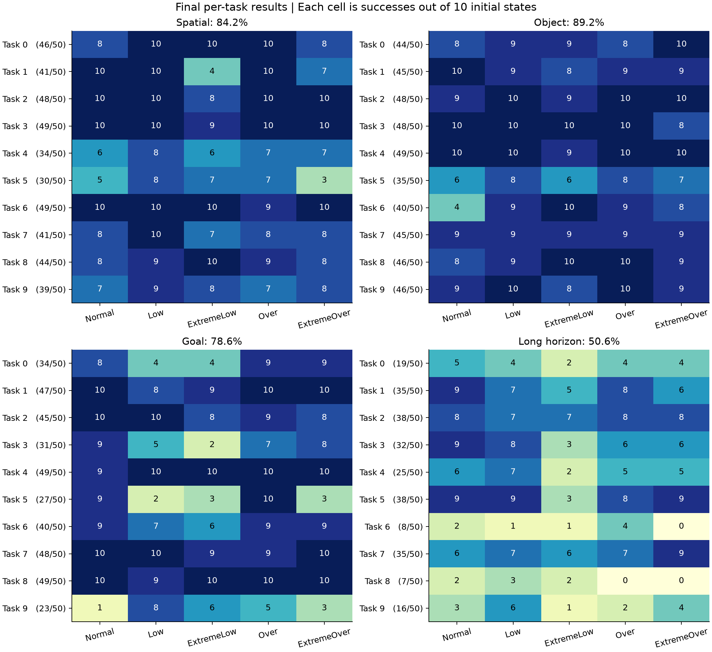

# C1 RAW＋本体感知＋任务语言策略：完整训练与闭环结果

2026-11-04 Asia/Shanghai。本报告汇总本轮已经完成的训练、开发选型和独立最终评价，不启动新的实验。原始运行过程、故障与恢复记录保留在[实验日志](raw_compact_c1_20261104.md)；设计与预定协议见[研究方案](../../docs/plans/RAW_COMPACT_POLICY_2026-11-04.md)。

## 1. 结论与选定模型

训练累计完成 **80,000 次优化器更新**；全部预定评估于 **2026-11-04 17:24:03 +08:00** 完成。按预定 Normal 开发集选中 **20,000 步 EMA**，开发成功率 **157/200＝78.5%**。同一模型在未参与本轮检查点选择的初态20–29、40个任务、五种照明上取得 **1513/2000＝75.65%**；其中 Normal 为 **309/400＝77.25%**。

这轮已经建立了 RAW＋本体＋语言的多任务仿真控制能力，明显改善了旧方案在重合小集上的成绩。但长任务五照明平均仅 **253/500＝50.6%**，极低照明长任务仅 **32/100＝32%**，尚未达到各类任务都稳定高成功率。结果限于当前三通道 pseudo-RAW 仿真与已知任务，不代表真实 Bayer 相机、真实机器人或未见任务泛化。

训练结束时的80,000步模型开发成绩为 **145/200＝72.5%**。后半程动作验证MSE继续降低，但闭环成功率下降；本轮保留20,000步模型作为选定策略。`training/policy.pt` 和 `training/latest.pt` 对应80,000步，不能当作本报告选定权重。



## 2. 平均成功率横评：光照、任务类别与RawVLA官方

以**五照明、四套件等权平均成功率**作为本轮主指标；本轮各单元样本数一致，它等于全部2000场的成功率75.65%。SOG是Spatial、Object、Goal三类平均，Long是LIBERO-10，计分为：

`总体 = (Spatial + Object + Goal + Long) / 4 = 0.75 × SOG + 0.25 × Long`

因此不能把SOG与Long各给50%权重。本轮SOG＝1260/1500＝84.00%，Long＝253/500＝50.60%，总体＝75.65%。五照明之间也等权；主比较固定同一个20k模型，不对每种光照分别挑最佳checkpoint。

官方对照统一采用[RawVLA论文v1主表Table 1](https://arxiv.org/html/2609.37530v1#S4.T1)的LIBERO结果。主参照选论文中总体最强的 **RawVLA＋π0.5（74.44%）**；Default ISP＋π0.5（51.52%）单列作参照。两者不能混称为“RawVLA官方成绩”。

### 2.1 光照维度

每行都是四类任务的平均成功率；Δ为本轮减RawVLA＋π0.5，单位是百分点。官方列为论文报告值，本轮列来自逐场实测。

| 光照 | C1本轮 | 官方RawVLA＋π0.5 | 官方Default ISP＋π0.5 | Δ百分点 |
|---|---:|---:|---:|---:|
| Normal | **77.25%** | 96.10% | 96.75% | -18.85 |
| Low | **79.75%** | 89.20% | 59.55% | -9.45 |
| ExtremeLow | **66.50%** | 38.72% | 3.60% | +27.78 |
| Over | **80.00%** | 81.50% | 75.95% | -1.50 |
| ExtremeOver | **74.75%** | 66.65% | 21.75% | +8.10 |
| Overall | **75.65%** | 74.44% | 51.52% | +1.21 |

本轮总体比官方最强单一后端报告值高 **1.21个百分点**。主要优势在ExtremeLow（+27.78）和ExtremeOver（+8.10）；主要差距在Normal（−18.85）和Low（−9.45）。因此现阶段更准确的判断是：极端照明下的直接RAW策略有潜力，正常/较温和条件下的基本操作能力仍需补强。数据支持数值比较，尚不足以宣称同协议稳定超越官方。

### 2.2 任务类别维度

这里先对每类任务平均五种照明。论文主表仅给SOG合并分数和Long，没有分别发布Spatial/Object/Goal分数；缺失项保持“未单列”，不从SOG反推。

| 任务类别 | C1本轮 | 官方RawVLA＋π0.5 | Δ百分点 |
|---|---:|---:|---:|
| Spatial | 84.20% | 未单列 | — |
| Object | 89.20% | 未单列 | — |
| Goal | 78.60% | 未单列 | — |
| SOG（三类合并） | **84.00%** | 79.82% | +4.18 |
| Long（LIBERO-10） | **50.60%** | 58.28% | -7.68 |
| 总体平均 | **75.65%** | 74.44% | +1.21 |

虽然平均成功率略高，长任务仍比官方低 **7.68个百分点**。本轮总体优势来自SOG，而不是长任务优势。

### 2.3 光照与任务类别交叉

以下每组两个数分别为“C1 / 官方RawVLA＋π0.5”，单位%。

| 光照 | SOG：本轮 / 官方 | Δ百分点 | Long：本轮 / 官方 | Δ百分点 |
|---|---:|---:|---:|---:|
| Normal | 83.33 / 98.40 | -15.07 | 59.00 / 89.20 | -30.20 |
| Low | 86.67 / 91.67 | -5.00 | 59.00 / 81.80 | -22.80 |
| ExtremeLow | 78.00 / 41.63 | +36.37 | 32.00 / 30.00 | +2.00 |
| Over | 89.33 / 89.00 | +0.33 | 52.00 / 59.00 | -7.00 |
| ExtremeOver | 82.67 / 78.40 | +4.27 | 51.00 / 31.40 | +19.60 |

ExtremeLow的总体优势主要由SOG带来；该条件Long仅比官方高2.00个百分点。Normal的Long相差30.20个百分点，Low的Long相差22.80个百分点。按提升总体平均的目标，应优先改善长任务和正常光基本操作，同时保留极端照明优势。



### 2.4 官方其他后端与比较范围

| 官方方法 | 五照明SOG | 五照明Long | 总体平均 | C1总体减该方法（百分点） |
|---|---:|---:|---:|---:|
| RawVLA + PI-0.5 | 79.82% | 58.28% | 74.44% | +1.21 |
| RawVLA + PI-0 | 76.33% | 50.12% | 69.78% | +5.87 |
| RawVLA + Qwen3-OFT | 68.07% | 44.76% | 62.24% | +13.41 |
| Default ISP + PI-0.5 | 53.92% | 44.32% | 51.52% | +24.13 |

上述官方数据均取自[同一论文主表](https://arxiv.org/html/2609.37530v1#S4.T1)。官网当前首页显示的跨三后端均值65.18%，与论文Table 1/正文的68.82%不同，本报告固定使用论文主表，未混用首页或附录消融数字。两种跨后端均值都不能代替最强单个策略74.44%。[官网展示](https://shuhongll.github.io/rawvla/)

官方主协议为每任务每照明50初态，共10,000场；本轮为10初态，共2,000场，初态/噪声种子未与官方逐场配对。两者同为40任务、五照明，当前EV范围与官方附录范围相符，但不能据此声称完整运行协议相同。官方训练学习ISP并保留预训练VLA，C1是无外部视觉预训练的紧凑联合策略；训练数据覆盖与优化过程也不同。本表是公开报告值横评，尚非同种子重现或统计显著性结论。[官方评估协议及训练入口](https://github.com/ShuhongLL/RawVLA#-rawvla-bench)

本项目2026-10-14测得的Default π0.5 LIBERO 58.20%是**本地历史复测**，不是RawVLA论文的Default51.52%或学习ISP后的74.44%；不拿它替代官方结果。[历史复测](2026-10-14_rawvla_pi05_complete_evaluation.md)

官方原始页面快照、版本与本轮交叉计算保存在[evidence/official-rawvla/](../../outputs/raw-compact-c1-20261104/final-results-20261104/evidence/official-rawvla/sources.json)及[比较JSON](../archives/2026-11-04_raw_compact_c1_vs_rawvla.json)。所有官方值保留论文小数，不由四舍五入后的百分数虚构成功场数。

## 3. 实际策略、数据和计算

| 项目 | 本轮实际配置 |
|---|---|
| 输入 | 两路当前256×256三通道uint8 pseudo-RAW；7关节角＋2手指位置；任务文字32 tokens |
| 视觉初始化 | 自有J5 RAW-only自监督step12818；没有RGB教师、RGB监督目标或外部视觉预训练权重 |
| 语言与动作 | T5-Efficient-Tiny结构随机初始化，仅复用公开文本tokenizer；CoRP式resampler、连续本体编码、单层768宽DiT flow动作头 |
| 规模 | 48,850,866总参数，48,850,482可训练参数 |
| 动作执行 | 预测12×7动作块，10步Euler采样；执行前5步后重新观察；无跨规划隐藏记忆 |
| 训练数据 | 原source-level拆分的1421训练源，五照明211114帧；均匀选任务，再选照明、轨迹、帧 |
| 离线验证 | 177验证源，1416 anchors，15042有效未来动作步；173个离线test源未用于本轮训练或选型 |
| 优化 | AdamW；全局batch256＝micro64×2卡×累积2；LR5e-5，warmup1000，80k余弦日程，EMA0.999 |
| 监督 | 有效动作flow matching＋0.01任务分类；状态标准化与动作q01/q99仅由训练源拟合 |
| 随机性 | 训练seed20261104，只有一次训练；逐场仿真seed保存在episodes.jsonl |
| 环境 | 双RTX5090 32GiB；Python3.12.3、Torch2.12.1+cu132、Transformers4.57.0；BF16混合精度 |

沿用成熟CoRP结构的来源及本地修改见[方案中的来源说明](../../docs/plans/RAW_COMPACT_POLICY_2026-11-04.md)和[模块来源清单](../../src/owac/frameworks/raw_compact/_vendor/provenance.json)。本轮是RAW适配能力实验，未把模块组合主张为新算法。

实现提交为`da194aa`，评估并行与首轮结果提交为`5935134`。后续SwanLab续写修复随本次v1.0一并归档；实际训练/评估执行源码以服务器运行根下`source/src`为准，历史版本另存`source-revisions/`，不能用发布提交代替各历史阶段的实际执行源码。完整解析配置见[config.json](../../outputs/raw-compact-c1-20261104/final-results-20261104/evidence/config.json)。

中断后用户提供新SSH入口`ssh -p 27786 root@183.249.99.226`。恢复前日志末尾68980，但完整检查点为68000；保留中断证据后从68000的模型、EMA、Adam及两rank RNG恢复到80,000。未落盘区间重算，不能称从68980精确续接。80,000是累计优化器步数，不是恢复后额外80,000步。

已记录的稳定训练局部更新约0.20秒、峰值allocated约9.02GiB/卡；不据此推算含验证、中断、仿真在内的完整GPU时长，也不把它当成机器人推理时延。完整墙钟、端到端推理p50/p95本轮未独立计量。

## 4. 评估协议与名称

| 指标名称 | 含义与本轮分母 |
|---|---|
| `success/libero_spatial/Normal` | 空间关系任务：根据物体之间的位置关系选择并操作目标；每套件10任务×5初态＝50场 |
| `success/libero_object/Normal` | 物体辨识任务：根据语言选择不同物体进行操作；50场 |
| `success/libero_goal/Normal` | 目标变化任务：按不同指令完成不同目标；50场 |
| `success/libero_10/Normal` | LIBERO-10长任务：多物体或多阶段操作；50场，名称中的10是任务数 |
| `success/overall` | 同一检查点200场Normal开发闭环的成功数/场次数；各套件等规模，因此也等于四套件成功率平均 |
| `success/episodes` | 一次开发评估的场次数，本轮为200；不是成功次数、训练batch或累计训练量 |
| `success/screening/*` | 1000步的40场初筛；与200场开发曲线分开 |
| `success/independent-final/*` | 选定20,000步策略的2000场最终评价；横轴仍为模型训练步数20,000 |
| `validation/action_mse` | 离线专家动作预测误差，越低表示离线误差越小；不等同闭环任务成功率 |

`Normal`、`Low`、`ExtremeLow`、`Over`、`ExtremeOver`依次为正常光、低照明、极低照明、过曝、极端过曝协议。它们是观测条件，不是五个模型；具体曝光/照明参数逐场记录。`Step`是优化器更新次数，纵轴0.8表示80%成功率。

本轮三种闭环协议严格分列：

- 初筛：1000步，Normal，40任务各初态5，40场，不参与后续选型。
- 开发：5000/10000/20000/40000/60000/80000步，Normal，40任务各初态5–9，每点200场；按这一相同协议选择检查点。
- 最终：只评估选定20,000步EMA，40任务各初态20–29、五照明，共2000场。所有照明使用同一权重，未按照明分别挑模型。

合计完成 **3240场原生闭环＝40初筛＋1200开发＋2000最终**。不同检查点和协议不能混在一起算一个模型成功率。逐场重算确认每个协议预期任务/照明/初态组合完整且唯一，汇总与原始逐场成功标记一致，已完成阶段退出收据均为native0。最早的导入故障发生在episode开始前，原日志保留，未计入成功分母。

“独立最终”仅指初态未参与本轮检查点选择：仍是同40个训练任务，不保证这些基准初态与示范状态完全不重合，也不是对173条离线test轨迹的动作验证。若下一轮根据本次失败调参，这2000场应转为开发证据，新的最终评价需使用另外预留的初态。

## 5. 开发选型与离线误差

| 优化器步数 | Spatial | Object | Goal | LIBERO-10 | 开发总体 | 验证动作MSE |
|---:|---:|---:|---:|---:|---:|---:|
| 5,000 | 39/50 | 42/50 | 34/50 | 13/50 | **128/200（64.00%）** | 0.074020 |
| 10,000 | 42/50 | 44/50 | 42/50 | 24/50 | **152/200（76.00%）** | 0.070180 |
| 20,000 | 43/50 | 44/50 | 44/50 | 26/50 | **157/200（78.50%）** | 0.067482 |
| 40,000 | 45/50 | 41/50 | 41/50 | 27/50 | **154/200（77.00%）** | 0.065303 |
| 60,000 | 42/50 | 36/50 | 41/50 | 28/50 | **147/200（73.50%）** | 0.064437 |
| 80,000 | 45/50 | 40/50 | 38/50 | 22/50 | **145/200（72.50%）** | 0.064370 |

1000步初筛为1/40，唯一成功属于Goal；因分母/初态协议不同，不放入上表曲线参与排序。

20k→80k的离线动作MSE从0.067482降至0.064370，降低约4.61%，但相同200个开发初态成功率从78.5%降到72.5%。逐场配对为 **新成功10场、原成功转失败22场，净减少12场**。80个离线验证点中最低MSE在65000步（0.0641754），该步没有原生闭环，不据此另选策略。

这支持“必须按闭环选型”，并不单独证明过拟合、视觉失效或某个模块退化。后续若诊断20k→80k退化，应从22个丢失成功的配对轨迹及其接触阶段入手。



## 6. 选定模型的最终成绩

表中每个套件×照明单元均为100场，所以82%即82/100。最后一列每套件500场，最后一行每种照明400场。

| 任务套件 | Normal | Low | ExtremeLow | Over | ExtremeOver | 五照明合计 |
|---|---:|---:|---:|---:|---:|---:|
| Spatial 空间关系 | 82% | 94% | 79% | 87% | 79% | 421/500（84.20%） |
| Object 物体辨识 | 83% | 93% | 88% | 93% | 89% | 446/500（89.20%） |
| Goal 目标变化 | 85% | 73% | 67% | 88% | 80% | 393/500（78.60%） |
| LIBERO-10 长任务 | 59% | 59% | 32% | 52% | 51% | 253/500（50.60%） |
| 四套件合计 | 309/400（77.25%） | 319/400（79.75%） | 266/400（66.50%） | 320/400（80.00%） | 299/400（74.75%） | **1513/2000（75.65%）** |

以Normal为参照，保持相同任务、初态和seed，ExtremeLow有41场从失败变成功、84场从成功变失败，净减少43/400，下降10.75个百分点。Low净增加10场，Over净增加11场，ExtremeOver净减少10场。照明难度并非对所有任务单调变化，当前单次训练及固定初态结果不能推出普遍的“越亮/越暗越好”规律。

487个失败中，Spatial79、Object54、Goal107、长任务247。长任务贡献约50.7%的全部失败，是当前最集中的提升空间。极低照明下Goal为67%、长任务32%，这两个套件比Object88%更脆弱。

只训练一次，未报告训练seed间均值/方差；同任务重复初态及五照明存在相关性，未把2000场当成2000个独立训练试验计算泛化置信区间。

## 7. 与旧方案的可比范围

旧J5＋π0.5本体感知方案最佳5000步为6/20。它只评估四套件各task0、Normal初态5–9。与C1重合这20场时：

| 策略 | 成功数 | 相对旧方案新增成功 | 相对旧方案退化 |
|---|---:|---:|---:|
| 旧J5＋π0.5本体，5000步 | 6/20（30%） | — | — |
| C1，5000步 | 13/20（65%） | 7 | 0 |
| C1，选定20000步 | **15/20（75%）** | **10** | **1** |
| C1，训练末80000步 | 10/20（50%） | 6 | 2 |

选定模型净增9/20，即45个百分点。配对确认任务、初态、seed和照明参数相同；模型、动作块/采样机制及训练覆盖不同。旧方案训练仅278条Normal源，C1为1421训练源/五照明，且后端改为紧凑联合学习。因此这是整体方案能力改善，不能把收益全部归因于“模型更小”“视觉不重要”或“更多数据”。旧方案没有相同2000场完整最终成绩，不能把旧30%与新75.65%直接当成同协议提升。

基线原始记录：[旧方案20场](../../outputs/raw-compact-c1-20261104/final-results-20261104/evidence/old-baseline-episodes.jsonl)，本轮配对结果见[机器可读汇总](../archives/2026-11-04_raw_compact_c1_results.json)的`old_baseline_overlap`。

## 8. 失败集中点与视频抽查

每任务共50场（五照明×10初态）。最弱的五个任务是：

| 套件/任务ID | 任务 | 成功数 |
|---|---|---:|
| LIBERO-10 / 8 | 两个摩卡壶都放上炉灶 | 7/50（14%） |
| LIBERO-10 / 6 | 白杯放盘上，布丁放盘右侧 | 8/50（16%） |
| LIBERO-10 / 9 | 杯子放进微波炉并关门 | 16/50（32%） |
| LIBERO-10 / 0 | 两种食品都放进篮子 | 19/50（38%） |
| Goal / 9 | 酒瓶放上架子 | 23/50（46%） |

为把统计与行为对应，抽查四段已完成视频，按六个时间点提取帧。以下只是定性样例，不是对全部487次失败的阶段标注；视频时间是20fps播放时间，不是实际推理墙钟。

- **长任务8，Normal，初态20，失败/520步**：操作一个壶后运动离开桌面可见区域，另一壶仍在桌上；没有完成双物体目标。[视频](../../outputs/raw-compact-c1-20261104/final-results-20261104/cases/long8-normal20.mp4) · [抽帧](../../outputs/raw-compact-c1-20261104/final-results-20261104/cases/long8-normal20.png)。
- **长任务6，Normal，初态21，失败/520步**：直到末段仍在处理杯子，未见第二物体布丁完成放置。需要区分首阶段低效/接触问题与后续任务切换，不能只按“长任务”标签认定是记忆缺失。[视频](../../outputs/raw-compact-c1-20261104/final-results-20261104/cases/long6-normal21.mp4) · [抽帧](../../outputs/raw-compact-c1-20261104/final-results-20261104/cases/long6-normal21.png)。
- **Goal3，初态20，同seed20263080**：Normal开抽屉并放碗，186步成功；ExtremeLow在300步结束时失败。此配对说明该初态的闭环对照明敏感，未证明RAW中关键信息必然丢失。[Normal视频](../../outputs/raw-compact-c1-20261104/final-results-20261104/cases/goal3-normal20.mp4) · [Normal抽帧](../../outputs/raw-compact-c1-20261104/final-results-20261104/cases/goal3-normal20.png) · [ExtremeLow视频](../../outputs/raw-compact-c1-20261104/final-results-20261104/cases/goal3-extremelow20.mp4) · [ExtremeLow抽帧](../../outputs/raw-compact-c1-20261104/final-results-20261104/cases/goal3-extremelow20.png)。

## 9. 研究判断与下一步

当前证据支持继续以C1作为RAW策略基线：在无RGB教师/外部视觉预训练的约4885万参数模型中，已获得可重复核算的多任务仿真成功。但数据覆盖、联合优化与策略结构同时变化，不能据此宣称视觉表征或模型结构都不重要。

| 原假设/问题 | 本轮证据与结论 | 下一项最有信息量的工作 |
|---|---|---|
| 旧视觉到大后端接口限制控制 | 重合20场由6成功增至15；数据覆盖同时增加 | 把C1作为能力基线；需要归因时再做同数据后端/初始化对照，不先扩大模型 |
| 只要继续降低动作MSE就会提高成功率 | 20k→80k MSE改善，开发成功净损失12场 | 固定20k参考，检查22条失去成功的配对轨迹及接触附近动作，不直接沿原配方加步数 |
| 长任务主要失败于记忆不足 | 长任务247次失败；样例同时存在首阶段低效、运动偏离与未完成后续操作 | 先对重点失败做阶段标注，区分目标辨认、接近、夹持、搬运、放置与阶段切换，再决定数据补充、接触纠错或因果历史 |
| 弱光使RAW信息不可用 | ExtremeLow下降10.75个百分点，但Object仍88% | 检查同初态RAW信号与动作分歧，区分信息不足、训练覆盖与策略敏感性；不直接认定前端失效 |
| 本体接口需要更直接的几何表达 | 本轮仅关节角/夹爪，输出末端增量；尚无加入末端位姿的收益证据 | 若接近/姿态失误突出，再比较一致坐标下机器人末端位姿/连续旋转输入，不加入物体真值 |

本次工作完成结果整理与基线归档；没有因上述建议启动新训练、重算闭环或恢复已删除的定时任务。

## 10. 交付、追溯与复算

当前服务器入口：`ssh -p 27786 root@183.249.99.226`。运行根为`/root/owac/repo/outputs/raw-compact-c1-20261104`，实际数据根为`/root/autodl-tmp/owac/raw-compact-c1-20261104`。

| 产物 | 位置/用途 |
|---|---|
| 选定完整检查点 | 服务器运行根`training/step-020000.pt`；模型、EMA及完整训练恢复状态保留 |
| 选定推理权重 | [policy-selected-020000-ema.pt](../../outputs/raw-compact-c1-20261104/final-results-20261104/policy-selected-020000-ema.pt)，195,535,466字节；来自20k完整检查点EMA，与最终评估选择一致 |
| 推理权重说明 | [policy-manifest.json](../../outputs/raw-compact-c1-20261104/final-results-20261104/policy-manifest.json)，记录源检查点、配置、开发/最终成绩；不含optimizer/RNG，恢复训练须使用原完整检查点 |
| 机器可读汇总 | [仓库中的小型结果JSON](../archives/2026-11-04_raw_compact_c1_results.json)；包含逐任务/照明、配对变化、开发与验证曲线 |
| 原始证据副本 | [evidence/snapshot.json](../../outputs/raw-compact-c1-20261104/final-results-20261104/evidence/snapshot.json)及展开后的config、status、逐阶段summary、episodes、退出码、训练metrics |
| 统计/绘图脚本 | [build_results.py](../../outputs/raw-compact-c1-20261104/final-results-20261104/build_results.py)，从逐场记录重算并生成三组PNG/SVG图 |
| 图表 | [最终矩阵SVG](results/raw_compact_c1_20261104/final-success-matrix.svg) · [训练与闭环SVG](results/raw_compact_c1_20261104/development-and-validation.svg) · [逐任务SVG](results/raw_compact_c1_20261104/task-lighting-grid.svg) |
| 完整视频与轨迹 | 服务器运行根各`development-*`和`independent-final/shard-*/raw/`；本地另存上述四个样例 |
| SwanLab | [OWAC统一训练run](https://swanlab.cn/@Jeong/OWAC/runs/owac-raw-compact-j5-20261104)，状态FINISHED，group=`C-raw-compact`，job_type=`raw-proprio-language-flow` |

推理导出只把选定EMA及配置组织为现有策略服务可读的格式，没有重新训练或插值。配置仍依赖服务器的文本tokenizer及软件环境；本次未另做可移植部署包或实机部署验证。原始完整检查点、80k末权重、历史失败和日志均保留。

SwanLab云端API已读回`success/independent-final/overall=0.7565`、`episodes=2000`，均位于step20000；开发末点`success/overall=0.725`位于step80000。原始读回见[swanlab-final-readback.json](../../outputs/raw-compact-c1-20261104/final-results-20261104/evidence/swanlab-final-readback.json)。本轮没有新增重复run或改写既有指标。

离线统计复算命令（仓库本地环境）：

```bash
.venv/bin/python outputs/raw-compact-c1-20261104/final-results-20261104/build_results.py
```

复算只依赖该目录内保存的证据，旧基线另存`evidence/old-baseline-episodes.jsonl`。它只读取结果、生成表图，不访问GPU或启动仿真。重复step的训练日志按最后实际记录取值绘图，中断前原始日志仍保留。官方横评表图由同目录`compare_rawvla.py`生成，报告由`write_report.py`组织。

本轮整理实际执行了3240条逐场记录的分母/覆盖/汇总重算、开发及照明配对、退出收据核对和云端最终指标读回；没有为纯文档变更重跑训练、模型行为测试或完整闭环。

## 附录：40个任务逐照明成绩

下表Normal至ExtremeOver的每个数均为成功场数/10；最后一列为五照明成功场数/50。任务ID为本轮环境中的0–9，不跨套件共享语义。



| 套件 / ID | 原生任务名称 | Normal /10 | Low /10 | ExtremeLow /10 | Over /10 | ExtremeOver /10 | 合计 |
|---|---|---:|---:|---:|---:|---:|---:|
| `libero_spatial` / 0 | `pick_up_the_black_bowl_between_the_plate_and_the_ramekin_and_place_it_on_the_plate` | 8 | 10 | 10 | 10 | 8 | 46/50 |
| `libero_spatial` / 1 | `pick_up_the_black_bowl_next_to_the_ramekin_and_place_it_on_the_plate` | 10 | 10 | 4 | 10 | 7 | 41/50 |
| `libero_spatial` / 2 | `pick_up_the_black_bowl_from_table_center_and_place_it_on_the_plate` | 10 | 10 | 8 | 10 | 10 | 48/50 |
| `libero_spatial` / 3 | `pick_up_the_black_bowl_on_the_cookie_box_and_place_it_on_the_plate` | 10 | 10 | 9 | 10 | 10 | 49/50 |
| `libero_spatial` / 4 | `pick_up_the_black_bowl_in_the_top_drawer_of_the_wooden_cabinet_and_place_it_on_the_plate` | 6 | 8 | 6 | 7 | 7 | 34/50 |
| `libero_spatial` / 5 | `pick_up_the_black_bowl_on_the_ramekin_and_place_it_on_the_plate` | 5 | 8 | 7 | 7 | 3 | 30/50 |
| `libero_spatial` / 6 | `pick_up_the_black_bowl_next_to_the_cookie_box_and_place_it_on_the_plate` | 10 | 10 | 10 | 9 | 10 | 49/50 |
| `libero_spatial` / 7 | `pick_up_the_black_bowl_on_the_stove_and_place_it_on_the_plate` | 8 | 10 | 7 | 8 | 8 | 41/50 |
| `libero_spatial` / 8 | `pick_up_the_black_bowl_next_to_the_plate_and_place_it_on_the_plate` | 8 | 9 | 10 | 9 | 8 | 44/50 |
| `libero_spatial` / 9 | `pick_up_the_black_bowl_on_the_wooden_cabinet_and_place_it_on_the_plate` | 7 | 9 | 8 | 7 | 8 | 39/50 |
| `libero_object` / 0 | `pick_up_the_alphabet_soup_and_place_it_in_the_basket` | 8 | 9 | 9 | 8 | 10 | 44/50 |
| `libero_object` / 1 | `pick_up_the_cream_cheese_and_place_it_in_the_basket` | 10 | 9 | 8 | 9 | 9 | 45/50 |
| `libero_object` / 2 | `pick_up_the_salad_dressing_and_place_it_in_the_basket` | 9 | 10 | 9 | 10 | 10 | 48/50 |
| `libero_object` / 3 | `pick_up_the_bbq_sauce_and_place_it_in_the_basket` | 10 | 10 | 10 | 10 | 8 | 48/50 |
| `libero_object` / 4 | `pick_up_the_ketchup_and_place_it_in_the_basket` | 10 | 10 | 9 | 10 | 10 | 49/50 |
| `libero_object` / 5 | `pick_up_the_tomato_sauce_and_place_it_in_the_basket` | 6 | 8 | 6 | 8 | 7 | 35/50 |
| `libero_object` / 6 | `pick_up_the_butter_and_place_it_in_the_basket` | 4 | 9 | 10 | 9 | 8 | 40/50 |
| `libero_object` / 7 | `pick_up_the_milk_and_place_it_in_the_basket` | 9 | 9 | 9 | 9 | 9 | 45/50 |
| `libero_object` / 8 | `pick_up_the_chocolate_pudding_and_place_it_in_the_basket` | 8 | 9 | 10 | 10 | 9 | 46/50 |
| `libero_object` / 9 | `pick_up_the_orange_juice_and_place_it_in_the_basket` | 9 | 10 | 8 | 10 | 9 | 46/50 |
| `libero_goal` / 0 | `open_the_middle_drawer_of_the_cabinet` | 8 | 4 | 4 | 9 | 9 | 34/50 |
| `libero_goal` / 1 | `put_the_bowl_on_the_stove` | 10 | 8 | 9 | 10 | 10 | 47/50 |
| `libero_goal` / 2 | `put_the_wine_bottle_on_top_of_the_cabinet` | 10 | 10 | 8 | 9 | 8 | 45/50 |
| `libero_goal` / 3 | `open_the_top_drawer_and_put_the_bowl_inside` | 9 | 5 | 2 | 7 | 8 | 31/50 |
| `libero_goal` / 4 | `put_the_bowl_on_top_of_the_cabinet` | 9 | 10 | 10 | 10 | 10 | 49/50 |
| `libero_goal` / 5 | `push_the_plate_to_the_front_of_the_stove` | 9 | 2 | 3 | 10 | 3 | 27/50 |
| `libero_goal` / 6 | `put_the_cream_cheese_in_the_bowl` | 9 | 7 | 6 | 9 | 9 | 40/50 |
| `libero_goal` / 7 | `turn_on_the_stove` | 10 | 10 | 9 | 9 | 10 | 48/50 |
| `libero_goal` / 8 | `put_the_bowl_on_the_plate` | 10 | 9 | 10 | 10 | 10 | 49/50 |
| `libero_goal` / 9 | `put_the_wine_bottle_on_the_rack` | 1 | 8 | 6 | 5 | 3 | 23/50 |
| `libero_10` / 0 | `LIVING_ROOM_SCENE2_put_both_the_alphabet_soup_and_the_tomato_sauce_in_the_basket` | 5 | 4 | 2 | 4 | 4 | 19/50 |
| `libero_10` / 1 | `LIVING_ROOM_SCENE2_put_both_the_cream_cheese_box_and_the_butter_in_the_basket` | 9 | 7 | 5 | 8 | 6 | 35/50 |
| `libero_10` / 2 | `KITCHEN_SCENE3_turn_on_the_stove_and_put_the_moka_pot_on_it` | 8 | 7 | 7 | 8 | 8 | 38/50 |
| `libero_10` / 3 | `KITCHEN_SCENE4_put_the_black_bowl_in_the_bottom_drawer_of_the_cabinet_and_close_it` | 9 | 8 | 3 | 6 | 6 | 32/50 |
| `libero_10` / 4 | `LIVING_ROOM_SCENE5_put_the_white_mug_on_the_left_plate_and_put_the_yellow_and_white_mug_on_the_right_plate` | 6 | 7 | 2 | 5 | 5 | 25/50 |
| `libero_10` / 5 | `STUDY_SCENE1_pick_up_the_book_and_place_it_in_the_back_compartment_of_the_caddy` | 9 | 9 | 3 | 8 | 9 | 38/50 |
| `libero_10` / 6 | `LIVING_ROOM_SCENE6_put_the_white_mug_on_the_plate_and_put_the_chocolate_pudding_to_the_right_of_the_plate` | 2 | 1 | 1 | 4 | 0 | 8/50 |
| `libero_10` / 7 | `LIVING_ROOM_SCENE1_put_both_the_alphabet_soup_and_the_cream_cheese_box_in_the_basket` | 6 | 7 | 6 | 7 | 9 | 35/50 |
| `libero_10` / 8 | `KITCHEN_SCENE8_put_both_moka_pots_on_the_stove` | 2 | 3 | 2 | 0 | 0 | 7/50 |
| `libero_10` / 9 | `KITCHEN_SCENE6_put_the_yellow_and_white_mug_in_the_microwave_and_close_it` | 3 | 6 | 1 | 2 | 4 | 16/50 |
